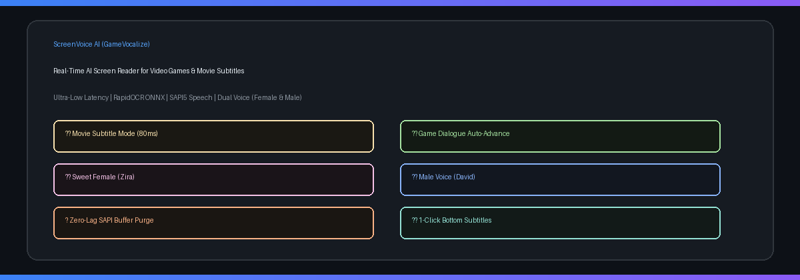
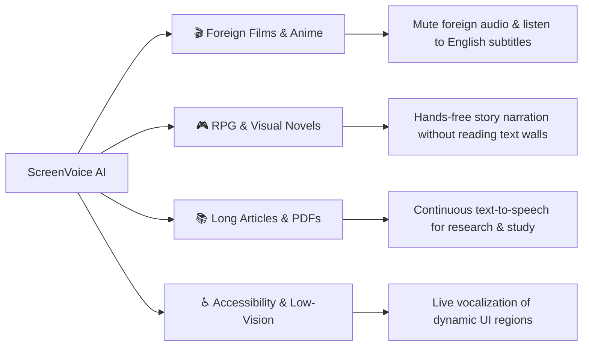
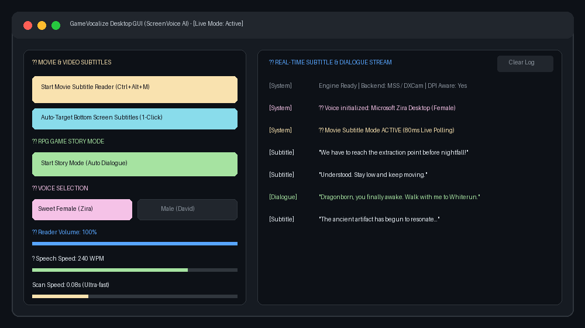

<div align="center">

# 🎬 ScreenVoice AI (GameVocalize) 🎮

### *Ultra-Fast Real-Time Screen Reader for Foreign Movie Subtitles & RPG Video Games*

[](https://github.com/lakshmikanth823/ScreenVoice-AI-)
[](https://python.org)
[-FF6F00?style=for-the-badge&logo=onnx&logoColor=white)](https://github.com/RapidAI/RapidOCR)
[](https://github.com/lakshmikanth823/ScreenVoice-AI-)
[](LICENSE)

<br/>



<p align="center">
  <b>Never miss a beat in fast-paced movies or miss line after line in story-heavy games.</b><br/>
  ScreenVoice AI vocalizes on-screen text instantly in a clear, natural voice with zero lag and automatic buffer purging.
</p>

[✨ Key Features](#-key-features) •
[🎯 Best Use Cases](#-best-use-cases--situations) •
[🖥️ Application Preview](#️-application-preview) •
[🚀 How to Use](#-how-to-use) •
[⌨️ Global Hotkeys](#️-global-hotkeys) •
[⚙️ Architecture](#️-architecture)

---

</div>

## ✨ Key Features

<table>
  <tr>
    <td width="50%">
      <h3>🎬 Ultra-Fast Movie Subtitle Mode</h3>
      <ul>
        <li><b>80ms Real-Time Scanning (~10 FPS)</b> for high-speed dialogue and scrolling video subtitles.</li>
        <li><b>1-Click Bottom Preset</b>: Instantly targets standard movie subtitle zones across any video player.</li>
        <li><b>Smart Text Cleaning</b>: Automatically filters out noise cues like <code>[Music]</code>, <code>♪</code>, <code>[Applause]</code>, and <code>(whispers)</code>.</li>
      </ul>
    </td>
    <td width="50%">
      <h3>🎮 RPG Story Game Reader Mode</h3>
      <ul>
        <li><b>Continuous Auto-Reading</b>: Reads page-by-page dialogues in games like <i>Skyrim, The Witcher 3, Baldur's Gate 3, Persona, Cyberpunk</i>.</li>
        <li><b>Zero-Lag Key Advance Hooks</b>: Pressing <kbd>Space</kbd>, <kbd>Enter</kbd>, or <kbd>E</kbd> in your game triggers an immediate 60ms refresh.</li>
      </ul>
    </td>
  </tr>
  <tr>
    <td width="50%">
      <h3>🎤 Sweet Voice Selection</h3>
      <ul>
        <li><b>👩 Sweet Female Voice (Microsoft Zira)</b>: Crystal-clear, soothing, and easy to understand during long sessions.</li>
        <li><b>👨 Deep Male Voice (Microsoft David)</b>: Rich and authoritative tone.</li>
        <li>Instant 1-click voice switcher & live sample test button.</li>
      </ul>
    </td>
    <td width="50%">
      <h3>⚡ Instant Hardware Audio Purge</h3>
      <ul>
        <li>Uses Windows SAPI5 <code>SVSFPurgeBeforeSpeak</code> flag.</li>
        <li><b>Zero Queue Backlog</b>: When a scene changes or a new line appears, previous audio is purged immediately so the voice never lags behind.</li>
        <li><b>Independent Volume Boost</b>: Boost speech up to 100% over video soundtracks.</li>
      </ul>
    </td>
  </tr>
</table>

---

## 🎯 Best Use Cases & Situations



### 1. 🍿 Watching Foreign Movies, TV Series & Anime
> **The Problem:** You are watching a foreign-language film (e.g. Japanese anime, Korean drama, Spanish thriller) with English subtitles. Reading subtitles non-stop forces your eyes away from the visuals, cinematography, and action.
>
> **The Solution with ScreenVoice AI:**
> 1. Start your video on YouTube, Netflix, VLC, or MPC-HC.
> 2. Lower or mute the video sound slightly.
> 3. Click **"Auto-Target Bottom Screen Subtitles"** and start **Movie Subtitle Mode**.
> 4. ScreenVoice AI reads every subtitle line out loud in real time with the **Sweet Female Voice**, letting you watch the video comfortably!

---

### 2. ⚔️ Story-Heavy RPG Games & Visual Novels
> **The Problem:** Games like *The Witcher 3, Baldur's Gate 3, Skyrim, Disco Elysium*, or Japanese Visual Novels feature thousands of lines of unvoiced or foreign dialogue boxes. Reading endless text walls strains your eyes.
>
> **The Solution with ScreenVoice AI:**
> 1. Press <kbd>Ctrl</kbd> + <kbd>Alt</kbd> + <kbd>D</kbd> and draw a box over the game's dialogue area.
> 2. Click **"Start Story Mode"** (or press <kbd>Ctrl</kbd> + <kbd>Alt</kbd> + <kbd>A</kbd>).
> 3. As you advance the story by pressing <kbd>Space</kbd> or <kbd>Enter</kbd>, ScreenVoice AI detects the new text line within 60ms and narrates it smoothly.

---

### 3. 👓 Accessibility for Low-Vision & Multitasking Users
> **The Problem:** Traditional screen readers attempt to parse the entire accessibility tree or DOM, often failing on DirectX games, video players, canvas elements, or graphic interfaces.
>
> **The Solution with ScreenVoice AI:**
> ScreenVoice AI uses pure computer vision and deep learning OCR directly from GPU/GDI frame buffers, making it universal across any application, game, or streaming window.

---

## 🖥️ Application Preview

<div align="center">
  
  <p><i>Modern CustomTkinter Dark Theme with real-time text stream log, voice switcher, and dedicated controls.</i></p>
</div>

---

## 🚀 How to Use

### Step 1: Quick Installation
Clone this repository and run the automated setup script:
```bash
git clone https://github.com/lakshmikanth823/ScreenVoice-AI-.git
cd ScreenVoice-AI-
setup.bat
```
*Or install dependencies manually via pip:*
```bash
pip install dxcam mss opencv-python numpy Pillow keyboard mouse pystray pywin32 customtkinter rapidocr_onnxruntime onnxruntime
```

### Step 2: Launch Application
Double-click `Start_GameVocalize.bat` or run:
```bash
python main.py
```

### Step 3: Choose Your Mode
- **For Movies / Videos**: Click **"📐 Auto-Target Bottom Screen Subtitles"** then click **"🎬 Start Movie Subtitle Reader"** (<kbd>Ctrl</kbd> + <kbd>Alt</kbd> + <kbd>M</kbd>).
- **For Video Games**: Click **"🎯 Custom Draw Dialogue Box"** (<kbd>Ctrl</kbd> + <kbd>Alt</kbd> + <kbd>D</kbd>) and drag around your game's subtitle/dialogue area, then click **"📖 Start Story Mode"**.
- **Pick Voice**: Switch between **👩 Sweet Female (Zira)** and **👨 Male (David)** using the segmented button on the left.

---

## ⌨️ Global Hotkeys

ScreenVoice AI hotkeys are globally registered, functioning seamlessly even while inside full-screen games or media players:

| Hotkey | Action | Description |
| :---: | :--- | :--- |
| <kbd>Ctrl</kbd> + <kbd>Alt</kbd> + <kbd>M</kbd> | **Toggle Movie Subtitle Mode** | Start or stop the ultra-fast 80ms subtitle scanner |
| <kbd>Ctrl</kbd> + <kbd>Alt</kbd> + <kbd>A</kbd> | **Toggle Story Mode** | Start or stop RPG dialogue reader |
| <kbd>Ctrl</kbd> + <kbd>Alt</kbd> + <kbd>D</kbd> | **Draw Target Region** | Open transparent overlay to drag and select screen area |
| <kbd>Ctrl</kbd> + <kbd>Alt</kbd> + <kbd>F</kbd> | **Read Full Screen** | Snap full screen and vocalize all detected text |
| <kbd>Ctrl</kbd> + <kbd>Alt</kbd> + <kbd>R</kbd> | **Read Selected Region** | Read the designated ROI immediately |
| <kbd>Ctrl</kbd> + <kbd>Alt</kbd> + <kbd>S</kbd> | **Silence Speech** | Instantly cut off ongoing speech |
| <kbd>Ctrl</kbd> + <kbd>Alt</kbd> + <kbd>X</kbd> | **Pause / Resume** | Master pause / resume toggle |
| <kbd>Ctrl</kbd> + <kbd>Alt</kbd> + <kbd>=</kbd> | **Increase Speed** | Accelerate speech rate (+20 WPM) |
| <kbd>Ctrl</kbd> + <kbd>Alt</kbd> + <kbd>-</kbd> | **Decrease Speed** | Lower speech rate (-20 WPM) |
| <kbd>Ctrl</kbd> + <kbd>Alt</kbd> + <kbd>Q</kbd> | **Quit Application** | Clean shutdown of all background workers |

---

## ⚙️ Architecture

```
Screen / Video Player / Fullscreen Game
       │
       ▼
 [ CaptureEngine ]  ──► DXCam (DirectX GPU) / MSS (Fast GDI) / PIL
       │
       ▼
 [ Preprocessor ]   ──► CLAHE LAB Color-Space Text Contrast Booster
       │
       ▼
 [ OcrEngine ]      ──► RapidOCR (ONNX Runtime PaddleOCR v4)
       │
       ▼
 [ Subtitle Cleaner]──► Strips [Music], ♪, Sound effect tags
       │
       ▼
 [ DedupEngine ]    ──► Fuzzy Sequence Matching (Diff rejection)
       │
       ▼
 [ TtsEngine ]      ──► Windows SAPI5 (Async + PurgeBeforeSpeak)
       │
       ▼
 [ Speakers / Audio Output ]
```

- **OCR Engine**: RapidOCR running lightweight ONNX inference (~15ms per region).
- **TTS Backend**: Native Windows SAPI5 (`win32com.client.Dispatch("SAPI.SpVoice")`) ensuring zero external API latency or network reliance.
- **DPI Scaling**: Process DPI awareness enabled to ensure exact 1:1 pixel coordinate alignment across 100%, 125%, and 150% Windows display scalings.

---

## 🤝 Contributing
Contributions, suggestions, and pull requests are warmly welcomed! Feel free to open an issue or submit improvements.

## 📄 License
This project is open-source under the [MIT License](LICENSE).
